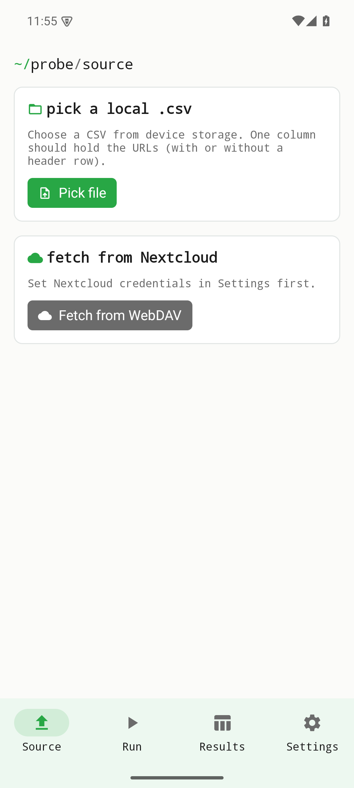
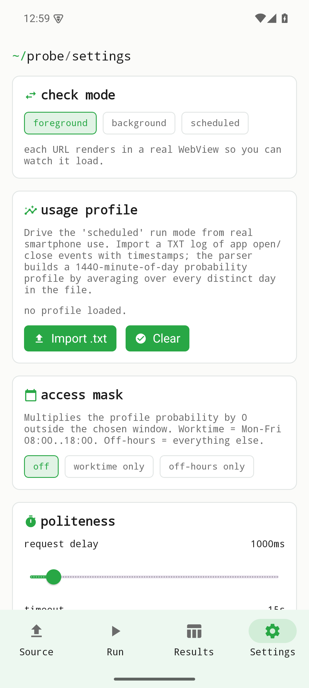

URLs aus einer lokalen CSV oder einer über Nextcloud-WebDAV geladenen CSV prüfen. Ergebnisdateien bleiben gespeichert und können geteilt oder hochgeladen werden. Allgemeiner Dateibrowser, Kontakte und Kalender sind nicht implementiert. Der Prüfbildschirm muss aktiv bleiben.

Diese Seite beschreibt den Quellstand vom Oktober 2026. Die Änderungen sind unveröffentlicht und nicht Teil älterer Entwicklungsreleases. Lokale Prüfungen ersetzen keine Geräte-, Live-Server- oder Store-Abnahme.

[Current status / Aktueller Stand / État actuel](../current-status.qmd)

Historische Bildschirmfotos aus v0.1.0; sie belegen keine Prüfung des aktuellen Quellstands.

{width=320}

{width=320}
