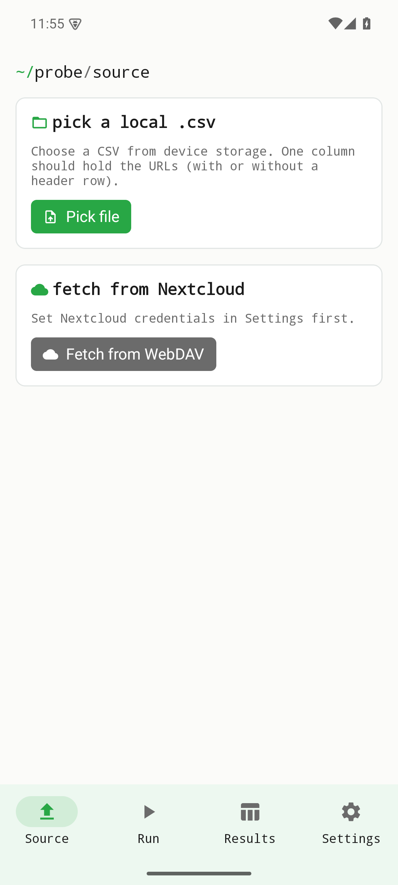
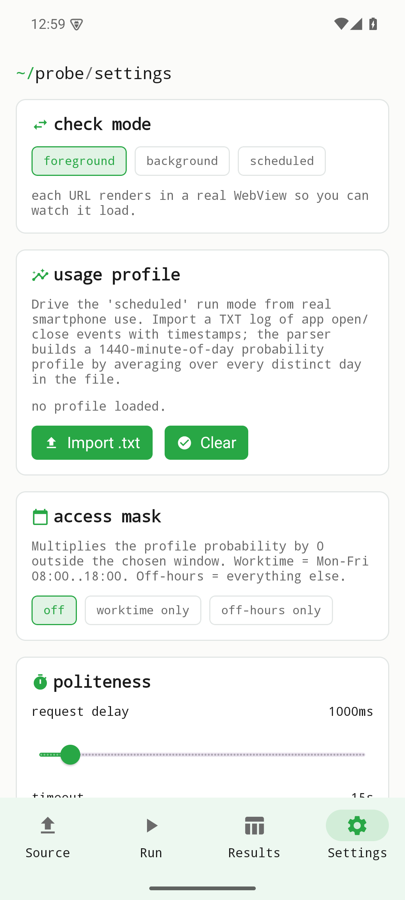

Check URLs from a local CSV or a CSV retrieved by Nextcloud WebDAV path. Keep and share per-run CSV results, optionally uploading them to Nextcloud. A general file browser, Contacts and Calendar are not implemented. Runs require the run screen to stay active.

This page describes the October 2026 source revision. These changes are unpublished and are not part of older development releases. Local checks are distinct from device, live-service and store acceptance.

[Current status / Aktueller Stand / État actuel](../current-status.qmd)

Historical screenshots from v0.1.0; these are not verification of the current revision.

{width=320}

{width=320}
