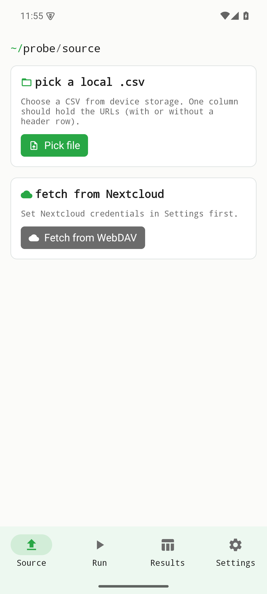
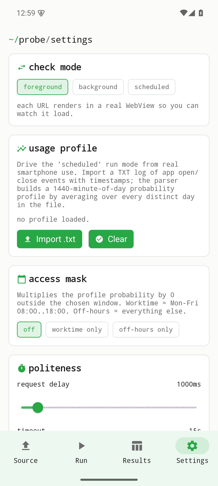

Vérifier les URL d’un CSV local ou récupéré via un chemin Nextcloud WebDAV. Conserver et partager les résultats CSV de chaque exécution, avec envoi facultatif vers Nextcloud. Le navigateur de fichiers général, les contacts et le calendrier ne sont pas implémentés. L’écran d’exécution doit rester actif.

Cette page décrit les sources d’octobre 2026. Ces modifications ne sont pas publiées et ne figurent pas dans les anciennes versions de développement. Les contrôles locaux ne remplacent pas la validation sur appareil, serveur réel ou boutique.

[Current status / Aktueller Stand / État actuel](../current-status.qmd)

Captures historiques de v0.1.0 ; elles ne constituent pas une validation de la version actuelle.

{width=320}

{width=320}
